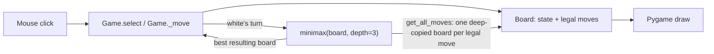

# Checkers AI

A complete game of Checkers in Python and Pygame where you play red against a computer opponent that picks its moves with **Minimax search**. The same code runs on the desktop and, compiled to WebAssembly with pygbag, in your browser.


## Play it

**[Play in the browser](https://shreyask06.github.io/checkerAiPy/)**: no install. The first load downloads the Python runtime, so give it a few seconds, then click the page to start.

Or run it locally (Python 3.9+):

```bash
pip install pygame
python main.py
```

You play **red** (bottom of the board) and move first. Click one of your pieces to see its legal destinations marked with blue dots, then click a destination. The computer plays **white** and answers immediately. When the game ends a banner says whether you won or lost; click anywhere to start a new game.

## What is implemented

| Area | Behaviour |
|---|---|
| Board | 8x8, 12 pieces a side, drawn at 600x600 |
| Movement | Men move one square diagonally forward; kings move diagonally in both directions |
| Captures | Jumps over an adjacent enemy piece, including **multi-jump chains** in a single move |
| Promotion | A piece that reaches the far row becomes a king (marked with a crown) |
| Game end | A side wins when the opponent has no pieces left |
| Opponent | Minimax to a fixed depth of 3 plies |

Captures are **not mandatory**: the move generator offers simple moves and jumps side by side, which is a common house rule rather than the strict tournament one.

## How it works



### 1. Board and move generation (`board.py`)

`Board` holds an 8x8 grid of `Piece` objects (or `0` for an empty square), the piece counts, and the king counts. `get_valid_moves(piece)` returns a dictionary mapping each reachable destination to the list of enemy pieces captured on the way there:

```python
{(5, 2): [],            # a simple move, captures nothing
 (3, 4): [<piece>]}     # a jump, captures one piece
```

Jumps are found by `_traverse_left` and `_traverse_right`, which walk a diagonal until they meet an enemy piece with an empty square behind it. After a landing they **recurse** in both directions, carrying the pieces already captured, so a chain of jumps becomes one move whose capture list holds every piece taken. Men only walk forward; kings walk both ways.

### 2. Minimax (`minimax/algorithm.py`)

White is the maximising player and red the minimising one. From the current position the search:

1. generates every legal move for the side to play (`get_all_moves`), producing one **independent copy of the board per move** (`deepcopy`), so the search never mutates the live game;
2. recurses with the roles swapped until it reaches depth 0 or a won position;
3. scores leaves with the evaluation function below and passes the best value back up;
4. returns the board that leads to the best value, which `Game.ai_move` adopts as the new position.

### 3. Evaluation (`Board.evaluate`)

```
score = white_pieces - red_pieces + 0.5 * (white_kings - red_kings)
```

Positive favours the AI. A man is worth 1 and a king is worth 1.5. It is deliberately simple: material only, with no notion of position.

### 4. The same file in the browser

`main.py` runs unchanged in both places. Its game loop is `async` and does `await asyncio.sleep(0)` every frame, which hands control back to the browser; pygbag needs that to keep the page responsive. The deploy workflow (`.github/workflows/pages.yml`) copies only `main.py` and `CheckersAI/` into a staging folder, builds it with `pygbag --build`, and publishes the result to GitHub Pages on every push to `main`. The AI searches synchronously, so in the browser the page may pause briefly while it thinks.

## Search cost, measured

How many positions the engine evaluates, and how long that takes, from the opening position with white to move. Timings are from one desktop CPU and will vary by machine; the position counts do not.

| Depth (plies) | Positions evaluated | Time |
|---|---|---|
| 1 | 7 | 0.002 s |
| 2 | 49 | 0.014 s |
| 3 (default) | 379 | 0.10 s |
| 4 | 2,872 | 0.84 s |

A typical mid-game position at depth 3 evaluated 501 positions in 0.21 s. Each extra ply multiplies the work by roughly 7 to 8, which is why depth 3 is the default: strong enough to punish careless play, fast enough to feel instant.

## Known limitations

These come from reading and testing the code, and are the honest edges of the project:

- **No pruning.** It is plain Minimax, so it examines every branch. Alpha-beta pruning would reach the same minimax value with far fewer positions examined.
- **Material-only evaluation.** The AI does not value the back row, the centre, or mobility, so it can play passively.
- **Ties go to the last move.** When several moves score equally, the last one generated is chosen, so the AI is deterministic but not varied.
- **King count can overcount.** `Board.move` increments the king counter whenever a piece lands on a back row, even a piece that is already a king, which slightly skews the evaluation after a king revisits a back row.
- **No stalemate handling.** A side that still has pieces but no legal move is not scored as a loss; in a test position the search returned no move at all.
- **Captures are optional** (see above), and there is no draw detection.
- **No automated tests** yet; behaviour was checked by playing and by timing the search.

## Project structure

```
main.py                     Pygame loop: input, AI turn, win/lose banner, restart (async for pygbag)
CheckersAI/
  board.py                  Board state, legal-move and jump generation, evaluation
  game.py                   Turn handling, piece selection, applying a move
  piece.py, constants.py    Piece drawing, colours, board dimensions
  crown.png                 King marker
  minimax/algorithm.py      Minimax search and move enumeration
.github/workflows/pages.yml Builds the WebAssembly version and deploys it to GitHub Pages
docs/images/                Screenshot used above
```

## Roadmap

- **Alpha-beta pruning** and move ordering, so the same time budget can search deeper.
- **A richer evaluation:** back-row guard, centre control, mobility, and advancement.
- **Fix the king-count and stalemate edges** listed above, and offer a mandatory-capture rule as an option.
- **Selectable difficulty** (search depth) and a "thinking" indicator.
- **Unit tests** for move generation, multi-jumps and promotion, using the position setups from the experiments behind this README.

## Tech stack

Python, Pygame, and pygbag (WebAssembly) with GitHub Actions and GitHub Pages for the browser build.
